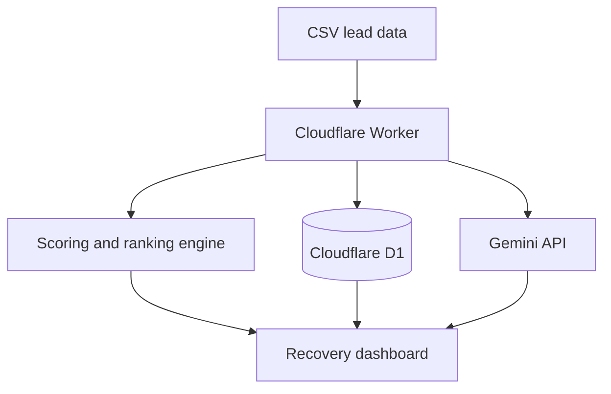

# Aureon Revenue Radar

Aureon Revenue Radar is an AI-assisted lead-recovery workspace for service businesses. It imports lead data, identifies high-value and stale opportunities, recommends the next action, tracks contact and sales outcomes, and measures recovered revenue.

This repository contains the public-safe V0.9.0 portfolio build. Credentials, API keys, account identifiers, private business data, and production configuration are not included.

## Business problem

Service businesses often pay to generate enquiries but lose revenue when leads, estimates, callbacks, and follow-ups are left inside spreadsheets or disconnected systems. Revenue Radar turns that data into a prioritized recovery queue.

## Core capabilities

- CSV lead import and normalization
- Priority scoring using value, status, age, and activity
- High-, medium-, and low-priority recovery queues
- Persistent lead storage with Cloudflare D1
- Persistent `Not contacted`, `Contacted`, `Won`, and `Lost` outcomes
- Won-value and active-recovery metrics
- Grounded AI analysis through Google Gemini
- Deterministic answers for rankings, stale leads, and daily action plans
- Signed owner sessions using HMAC-SHA256
- Cloudflare Worker API routes and single-page interface

## Architecture



## API routes

| Route | Purpose |
| --- | --- |
| `POST /api/login` | Verify the owner password and create a signed session |
| `POST /api/logout` | End the owner session |
| `GET /api/leads` | Load persisted leads for a business |
| `POST /api/leads/import` | Validate and persist imported leads |
| `GET /api/actions` | Load saved lead outcomes |
| `POST /api/action` | Update a lead outcome |
| `POST /api/ask` | Generate a grounded analysis or recovery recommendation |

## Technology

- JavaScript
- Cloudflare Workers
- Cloudflare D1 / SQL
- Google Gemini API
- REST-style APIs
- HTML and CSS
- Web Crypto API

## Local and Cloudflare setup

1. Install Wrangler and authenticate with Cloudflare.
2. Create a D1 database.
3. Apply `schema.sql` to the database.
4. Copy `wrangler.example.toml` to `wrangler.toml` and add your D1 database ID.
5. Configure these secrets with Wrangler:

```bash
wrangler secret put AUREON_OWNER_PASSWORD
wrangler secret put AUREON_SESSION_SECRET
wrangler secret put GEMINI_API_KEY
```

6. Run locally with `wrangler dev` or deploy with `wrangler deploy`.

Never commit `wrangler.toml`, passwords, session secrets, API keys, customer files, or production database identifiers.

## CSV fields

Revenue Radar accepts common variations of these fields:

- Lead or customer name
- Service
- Potential value
- Lead status
- Days inactive or age
- Last activity
- Business name

## Current status

V0.9.0 is a working portfolio prototype. Owner authentication, CSV import, lead persistence, action persistence, scoring, reporting metrics, closed-lead exclusion, and Gemini analysis were implemented and tested. It is not presented as a multi-tenant production SaaS.

## Skills demonstrated

- Full-stack AI application development
- API design and input validation
- Database persistence and SQL
- Authentication and signed sessions
- AI grounding and deterministic fallbacks
- Business-process analysis
- Lead scoring and revenue-recovery logic
- Secure public portfolio packaging

## Author

Built by **Owoeye Iyanu — Aureon AI**  
Building Intelligent Business Systems.
